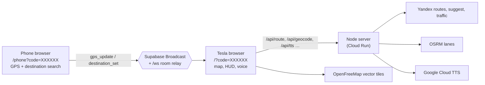

# Tesla Navi

Turn-by-turn navigation for the Tesla in-car browser, built for regions where Tesla's own navigation doesn't route (Armenia today, Georgia next). The driver's phone supplies precise GPS and destinations; the car's touchscreen shows a live map with Yandex traffic-aware routing, a turn-by-turn HUD, voice guidance in Russian, Armenian and English, lane arrows and speed-camera alerts.

**Production:** https://tesla-navi-466066606601.europe-central2.run.app (Google Cloud Run, see [docs/DEPLOYMENT.md](docs/DEPLOYMENT.md))

## How it works



1. The car screen generates a 6-character pairing code and shows a QR code.
2. The driver scans it; the phone page streams GPS (~1 Hz) and sends destinations.
3. The car builds a route through the server (Yandex live router, OSRM for lane data), shows alternatives, then navigates: road snapping, maneuver countdown, voice prompts, off-route rerouting, speed cameras along the route.

Details: [docs/ARCHITECTURE.md](docs/ARCHITECTURE.md).

## Features

| Area | What it does |
|---|---|
| Pairing | 6-char code + QR, Supabase Broadcast with a local WebSocket fallback, heartbeat and connection status |
| Map | MapLibre GL vector map with MapsEV-style day/night/auto themes, 2D/3D buildings, heading-up / north-up, auto re-follow; Yandex map option; automatic Leaflet/OSM fallback when MapLibre can't load or WebGL is missing |
| Routing | Yandex live router with up to 3 alternatives and traffic-colored polylines, OSRM fallback, off-route rerouting that drives on with the fastest new route (no choice offered mid-drive) |
| Guidance | Maneuver HUD with countdown, lane arrows (OSRM lanes matched onto the Yandex route), progress bar with ETA, real traffic delay per route |
| Voice | ru/en Google Cloud TTS neural voices (female/male), Armenian prerecorded Gor/Suzie, chime, mute |
| Safety | ~500 speed cameras across Armenia (OpenStreetMap + SpeedCamOnLine.ru) and red-light cameras at ~20 junctions, announced only along the active route and in the camera's direction; road limits from OpenStreetMap `maxspeed`, and where a street has no tag the legal default 60 in built-up areas / 90 outside (dashed); camera limit wins near a camera; overspeed chime on camera/OSM limits |
| Places | Search (Yandex Suggest → Photon → Nominatim), Google/Yandex link and coordinate parsing, Home/Work, favorites, history |
| Phone remote | GPS sharing with wake lock, address search, link paste, voice dictation, "Send to Tesla" |
| Extras | Weather at the car's position (Open-Meteo), YouTube search/player, 105 EV charging stations from OpenStreetMap, Yerevan traffic score badge |
| GPS | Phone GPS preferred; the car browser's own geolocation takes over automatically when the phone is silent |
| Dev tools | `?mode=dev` simulator (preset routes, speeds, scrubbing) and diagnostics panel; `npm run verify` |

Languages: Russian (default), Armenian, English.

## Quick start

```bash
npm install          # Node >= 20
npm start            # http://localhost:8085
```

- Car screen: http://localhost:8085/?code=TEST01 (add `&mode=dev` for the simulator)
- Phone remote: http://localhost:8085/phone?code=TEST01

Geolocation on a real phone needs HTTPS: use the production URL or a tunnel (`ngrok http 8085`). See [docs/DEVELOPMENT.md](docs/DEVELOPMENT.md).

## Checks

```bash
npm run check        # syntax check of all JS
npm test             # unit tests (node:test, ~1 s, no network)
npm run verify       # 12 headless browser checks in system Chrome (~45 s, needs network)
```

## Project structure

```
server.js                 HTTP server, /api/*, /ws relay, static allowlist
index.html, phone.html    Car screen and phone remote pages
js/                       config + i18n, realtime, map engine, car UI, phone UI
css/  styles/  sounds/    Styles, MapLibre map styles + sprites, audio
data/                     Camera database (speed + red-light), OSM charging stations and speed limits
scripts/                  verify runner + checks, Armenian voice generators
docs/                     Architecture, API, deployment, development, ADRs, playbooks
AGENTS.md                 Instructions for AI coding agents (CLAUDE.md / GEMINI.md import it)
```

## Documentation

- [Architecture & system design](docs/ARCHITECTURE.md)
- [API reference](docs/API.md)
- [Deployment](docs/DEPLOYMENT.md)
- [Development guide](docs/DEVELOPMENT.md)
- [Architecture decision records](docs/adr/)
- [Agent playbooks](docs/playbooks/) and [AGENTS.md](AGENTS.md)
- [Design tokens](DESIGN.md)

## Working with AI agents

`AGENTS.md` is the single source of truth for Claude Code, Codex/GPT, Gemini, Cursor and Copilot; `CLAUDE.md`, `GEMINI.md` and `.github/copilot-instructions.md` only import or point to it. Procedures (verify, release check, code review, adding a voice phrase) live in `docs/playbooks/` so every agent follows the same steps; they are also exposed as skills in `.agents/skills/` (Agent Skills format) and `.claude/skills/`, plus a `nav-reviewer` review agent for Claude Code.

| Tool | Reads |
|---|---|
| Codex / GPT, Cursor, Jules, Aider and other AGENTS.md-aware agents | `AGENTS.md` |
| Claude Code | `CLAUDE.md` → imports `AGENTS.md`; `.claude/skills`, `.claude/agents` |
| Gemini CLI / Gemini Code Assist | `GEMINI.md` → imports `AGENTS.md` |
| GitHub Copilot | `.github/copilot-instructions.md` → points to `AGENTS.md` |

## License

MIT
