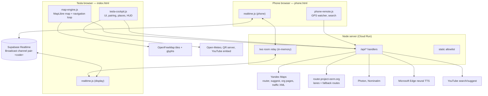
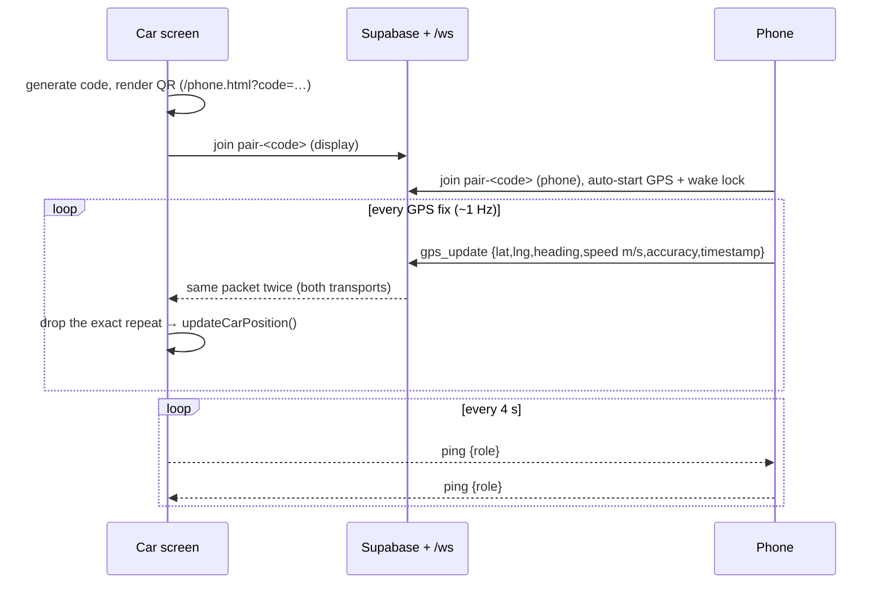
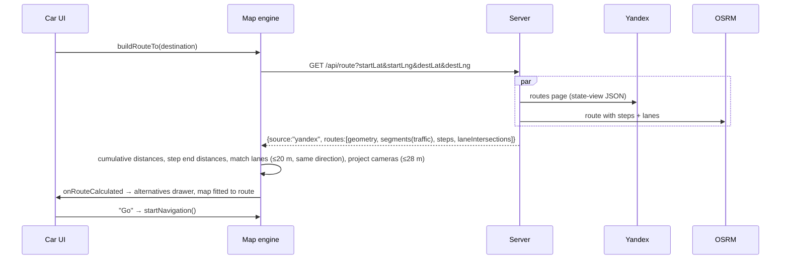
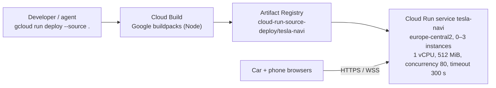

# Architecture & System Design

Tesla Navi is a two-screen, real-time navigation system that runs entirely in browsers plus one small Node server. This document describes the problem, the components, the main data flows, the navigation engine, deployment topology, failure modes and known limits. Decisions and their trade-offs are recorded in [adr/](adr/).

## 1. Problem and constraints

- Tesla cars imported into Armenia/Georgia have no working built-in navigation for local roads. The in-car browser (Chromium on Linux) is available, but **its Geolocation API is unreliable or blocked** and the MCU is slow (Intel Atom on older cars, AMD Ryzen on newer).
- The driver's phone has accurate GPS, a compass and mobile data.
- The UI is used while driving: glanceable, large touch targets, nothing that blocks the map, and guidance must never be wrong (a wrong "turn left" is worse than silence).

Hence: the phone is the GPS sensor and input device, the car screen is the display, both are plain web pages, and all third-party data is fetched through our server.

## 2. System context

## 3. Components

### 3.1 Server — `server.js`

Single `http.createServer` handler plus a `ws` WebSocketServer on `/ws`. No framework, no database.

| Responsibility | Notes |
|---|---|
| Static files | Only `index.html`, `phone.html` and `css/ js/ styles/ sounds/` (`PUBLIC_FILES`/`PUBLIC_DIRS`); dotfiles and traversal rejected. `/` and `/map` → `index.html`, `/phone*` → `phone.html`. |
| `/api/route` | Fetches the Yandex Maps routes page and parses the embedded `state-view` JSON (`config.routerResponse.routes`): geometry, traffic colorization, segments → steps, speed-limit heuristic, route summaries. OSRM is queried in parallel for lane data and is the fallback router. |
| `/api/geocode`, `/api/resolve-location` | Yandex Suggest (with word-order and language fallbacks) → org-page coordinates → Photon → Nominatim. `resolve-location` also expands Google/Yandex/Apple/2GIS share links (allowlisted hosts, redirects re-checked). |
| `/api/tts` | ru/en via `msedge-tts` (LRU cache, 300 entries, text ≤ 300 chars); Armenian via prerecorded clips chosen by `getArmenianAudio()`, 404 for unknown phrases. |
| `/api/traffic-yerevan` | Yandex traffic score XML for Yerevan (60 s cache); elsewhere `available: false` (no data, never a guess). |
| `/api/speed-cameras` | Serves `data/yerevan-cameras-clean.json` (~185 cameras, OSM ids). |
| `/api/chargers` | Serves `data/ev-chargers.json`: the 105 car charging stations OpenStreetMap has in Armenia (snapshot refreshed by `scripts/update_chargers.mjs`; Overpass is too slow to query per request). No availability data exists. |
| `/api/yt-search`, `/api/yt-suggestions` | YouTube HTML/InnerTube scraping and Google suggest. |
| Cross-cutting | Every upstream fetch has a 12 s deadline (`fetchUpstream`); `/api/*` is rate-limited per client IP (last `X-Forwarded-For` entry; token bucket: burst 60, ~120/min, 429 + `Retry-After`; at most 10 000 tracked clients). |
| `/ws?room=<code>` | Rooms in a process-local `Map`; every frame is relayed to the other members of the room, preserving text/binary type. |

### 3.2 Realtime — `js/realtime.js`

`TeslaRealtime` is shared by both pages (`role: 'display' | 'phone'`):

- Joins Supabase Broadcast channel `pair-<code>` **and** the local `/ws?room=<code>`; every send goes over both.
- Receivers drop exact repeats (kind + timestamp + lat/lng of the last 64 packets), so a second phone or a skewed clock is never silenced.
- Local WS reconnects with exponential backoff (1 s → 15 s) and on tab visibility.
- Heartbeat: ping every 4 s; the display marks the phone lost after 8 s without packets.

Message formats: [API.md](API.md#realtime-messages).

### 3.3 Car screen — `index.html`, `js/tesla-cockpit.js`, `js/maps/map-engine.js`

- `tesla-cockpit.js` owns all DOM: i18n application, pairing modal + QR, saved places (Home/Work/favorites), search and history, route-alternatives drawer, HUD and lane pill, progress bar, chargers, weather, YouTube player, dev simulator/diagnostics. It wires UI callbacks into the engine.
- `TeslaMapEngine` owns the map and the navigation state machine (section 5). Providers: MapLibre (default, deferred `<script>`), Yandex Maps JS (`provider=yandex`, loaded on demand; falls back to MapLibre) and Leaflet/OSM (`provider` becomes `osm`, loaded on demand when MapLibre can't load or start, e.g. CDN down or no WebGL). The toolbar badge shows the engine actually running.
- **GPS sources:** the paired phone wins; the car browser's own geolocation is used only when no phone fix arrived within 5 s, so two receivers never alternate.
- Scripts are classic (non-module) and load in order: `config.js`, `realtime.js`, `map-engine.js`, `tesla-cockpit.js`; MapLibre and supabase-js (pinned 2.118.0) come from CDNs.

### 3.4 Phone remote — `phone.html`, `js/phone-remote.js`

Auto-starts `watchPosition` (high accuracy), derives heading from movement when the device gives none, keeps a screen wake lock (re-acquired on return to the tab), shows the age of the last fix, resolves typed addresses/links via `/api/resolve-location` and sends `destination_set`. Its language comes from the car's QR code (`&lang=`), else the browser language.

### 3.5 Client state (localStorage)

| Key | Content |
|---|---|
| `tesla_navi_lang`, `tesla_navi_voice` | UI language (ru/hy/en), voice gender |
| `tesla_map_provider_v2`, `tesla_map_theme`, `tesla_map_3d_mode` | Map provider, auto/day/night, 2D/3D |
| `tesla_last_coords` | Last known position (start center after reload) |
| `tesla_saved_places` | Home, Work, favorites (defaults seed only the first run) |
| `tesla_search_history` | Last 25 destinations |
| `tesla_yt_history`, `tesla_yt_user`, `tesla_mini_player_pos` | Music player state |

There is no server-side user state.

## 4. Key flows

### 4.1 Pairing and GPS streaming

### 4.2 Building a route

If Yandex fails, the OSRM response is returned (`source: "osrm"`) and the route is drawn in one neutral color (no traffic information).

## 5. Navigation engine (`TeslaMapEngine`)

Per position update (`updateCarPosition(lat, lng, heading, speedKmh, isRealFix)`):

1. **First real fix** snaps the camera directly to the car (no smoothing from the default center).
2. **Heading**: frozen below 2.5 km/h; otherwise bearing between raw fixes ≥ 6 m apart, or the simulator heading.
3. **Map matching** (`snapToActiveRoute`): nearest polyline segment in a window around the last progress index (full scan fallback); snap if ≤ 28 m and heading difference ≤ 55° while moving; arrow locked to the road tangent 22 m ahead.
4. **Off-route**: > 20 m from the route, or > 12 m with > 45° heading difference; two consecutive real fixes while navigating → `recalculateRoute()` from the current position.
5. **Smoothing**: jump on > 60 m shifts, freeze micro-moves when stationary, 35 % EMA when off-route, heading deadband 3.2°.
6. **Camera**: heading-up with top padding 28 % while following; user pan stops following, auto re-follow after 6 s idle or when driving.
7. **Progress** (`trackNavigationProgress`, only while navigating):
   - Distance along route → progress %, remaining distance/time, ETA, traveled line.
   - Step index advances when within 25 m of the step end. **The maneuver shown/announced for the current step's end is `steps[k+1]`** (maneuvers sit at step starts); on the last step the target is the destination.
   - Voice: "in 300 m …" between 350–100 m, immediate prompt between 85–15 m, once per step.
   - Lanes: nearest matched OSRM junction within 220 m ahead.
   - Cameras on the route: chime + voice once between 350–80 m; badge within 600 m.
   - Speed limit: a route camera within 200 m ahead (50 m after) gives the verified limit; otherwise the step's street-name estimate, drawn as a dashed sign. The overspeed chime uses verified limits only.
   - Arrival within 25 m of the destination → arrival modal, route cancelled.
8. While a route is only previewed (not navigating) only the free-driving camera check runs.

Route rendering (MapLibre) uses a fixed set of sources/layers — alternatives, casing, one data-driven traffic layer, traveled line — and is replayed after day/night style swaps.

## 6. Deployment topology

Details and commands: [DEPLOYMENT.md](DEPLOYMENT.md).

### Scaling consequences (important)

- **`/ws` rooms are per instance.** With up to 3 instances and no session affinity, the phone and the car can land on different instances and never meet on the local relay; they then communicate only through Supabase. Each instance also has its own TTS and traffic caches.
- **Cloud Run closes requests after the 300 s timeout, WebSockets included.** The client reconnects (backoff), so the local channel flaps every 5 minutes; Supabase carries traffic in between.
- Options: enable session affinity (best effort), cap the service at 1 instance, move rooms to a shared broker, or treat Supabase as primary and the local relay as a dev convenience. See [adr/0003](adr/0003-dual-realtime-transport.md).

## 7. Security model

- **Trust boundaries:** the pairing channel is public to anyone who knows the 6-character code (Supabase anon key is public by design). Everything received on it is untrusted: destination packets are validated, and all external/untrusted text is escaped before reaching `innerHTML`.
- **Server:** only the front-end is served; `/api/resolve-location` fetches only allowlisted map-link hosts and re-checks each redirect (SSRF); TTS input is length-limited and the cache bounded.
- **No accounts, no server-side personal data.** Personal data lives in the car browser's localStorage.
- Pairing codes use `crypto.getRandomValues`; `/api/*` is rate-limited per IP and every upstream call has a deadline.
- Open items: scraping endpoints can be blocked by upstreams at any time; the rate limiter is per Cloud Run instance.

## 8. Performance constraints (Tesla MCU)

- MapLibre runs with `fadeDuration: 0`, `maxTileCacheZoomLevels: 1`, `antialias: false`, `renderWorldCopies: false`, WebGL context-loss handling.
- Route = ~6 layers regardless of traffic segment count; cameras are pre-projected once per route; map matching searches a local window.
- Avoid per-frame work during real driving (the extrapolator only runs in the simulator); avoid unbounded DOM (dev log capped at 400 lines).

## 9. External dependencies and failure modes

| Dependency | Used for | If it fails |
|---|---|---|
| Yandex Maps (scraped page + suggest + XML) | Routes, traffic, geocoding, score | Routes fall back to OSRM (no traffic, neutral color); geocoding to Photon/Nominatim; the score badge shows a dash. Page format changes break parsing silently. |
| OSRM public demo server | Lanes, fallback routes | No lane arrows; no fallback route. Rate-limited, no SLA. |
| Supabase Realtime | Primary pairing channel | Local `/ws` only (per-instance, see 6). |
| Microsoft Edge TTS (`msedge-tts`) | ru/en voice | Prompt fails (chime only); one retry. |
| OpenFreeMap tiles/glyphs | Base map | Blank map. |
| CDNs (unpkg, jsdelivr, api-maps.yandex.ru) | MapLibre, Leaflet, supabase-js, Yandex JS | MapLibre unavailable → Leaflet/OSM map; Yandex JS unavailable → MapLibre; supabase-js unavailable → local `/ws` only. |
| OpenStreetMap / Overpass | Charging-station snapshot (offline refresh) | Nothing at runtime; the snapshot just ages. |
| Open-Meteo, YouTube, api.qrserver.com | Weather, music, QR | Feature unavailable. |

Heuristic data that remains, and how it is presented: speed limits from street names (dashed "estimate" sign, no chime); the YouTube home feed is a curated list of existing videos. Battery levels, charger availability, traffic guesses, ping/satellite labels and fixed POIs were removed.

## 10. Testing strategy

- `npm run check` — syntax.
- `npm test` — 18 `node:test` unit tests, no network: server parsing (links, protobuf URIs, `parseYandexRoutes`), Armenian clip mapping, allowlist, rate limit, upstream timeout; the map engine loaded in a `vm` with DOM stubs (maneuver = `steps[k+1]`, silent preview, voice text, lane matching, speed-limit source); realtime dedup and pairing codes.
- `npm run verify` — 10 headless Chrome checks against a local server with live upstreams: smoke, maneuver vs. geometry, route layers + theme swap, XSS through the pairing channel, dual GPS, translations, Yandex provider, MapLibre-CDN-blocked and no-WebGL fallbacks, phone remote. See [playbooks/verify.md](playbooks/verify.md).
- CI (`.github/workflows/ci.yml`): check + unit tests block merges; browser checks run but don't block (live upstreams from GitHub's network).
