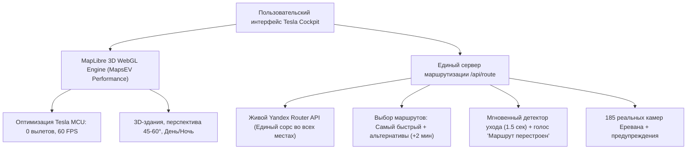

# 🗺️ План разработки гибридной навигации: MapsEV 3D + Яндекс «Мозг»

Этот документ фиксирует архитектурный план и обновляется по каждому этапу.
Все задачи выполняются строго по очереди с локальной проверкой в браузере перед развертыванием.

---

## 🎯 Главная цель гибрида
Взять **лучшее от MapsEV** (легкий 60 FPS 3D-интерфейс, аппаратная оптимизация под процессор Теслы Intel Atom / AMD Ryzen, сохранение памяти, предотвращение падений браузера) и соединить с **лучшим от Яндекса** (100% единый живой источник маршрутов с реальными пробками Еревана, мгновенный перемаршрут, знаки полос, камеры и человеческий голос), полностью исключив слабый и кривой роутер OSM.

---

## 🚨 Приоритетные задачи (Реальные дорожные исправления)

### ⚡ Задача A: Мгновенное и плавное перестроение маршрута (как в Яндекс.Навигаторе) — ЗАВЕРШЕНО ✅
> **Решено:** Устранена задержка в 500 м при съезде с дороги. Стрелка больше не прыгает назад на старую улицу. Уход с дороги определяется за ~1.5 секунды (2 тика GPS).
- [x] **A1. Умный Road Snapping с проверкой курса:**
  - При скорости $\ge 8$ км/ч привязка к дороге работает только при расстоянии $\le 20$ м **И** совпадении курсового угла ($\Delta \le 45^\circ$).
  - При повороте на боковую улицу ($\Delta > 45^\circ$) привязка мгновенно отключается, исключая обратные рывки на старую дорогу.
- [x] **A2. Быстрый детектор ухода с маршрута (1.5–2 секунды вместо 500 метров):**
  - Порог снижен до 20 м (или 12 м при угле поворота $> 45^\circ$).
  - Подтверждение снижено до 2 последовательных тиков реального GPS (~1.5 сек).
  - Мгновенный вызов `recalculateRoute(currentLat, currentLng)`.
- [x] **A3. Плавный пересчет без дерганий и зависаний:**
  - Во время пересчета стрелка плавно следует по реальному GPS с 35% EMA-фильтром.
  - Звуковой сигнал и голосовое оповещение: *«Маршрут перестроен»*.
- [x] **A4. Устранение зависания карты (в режиме Яндекс и 3D):**
  - Добавлен защитный тайм-аут 200 мс на снятие флага `_isYandexCentering`.
  - Устранена перегрузка тайловой сетки Яндекса при непрерывном центрировании.

---

### ⚡ Задача B: Выбор вариантов маршрута из Яндекса (Самый быстрый + Альтернативы) — ЗАВЕРШЕНО ✅
> **Решено:** Из живого Яндекса берутся все варианты пути с учетом реальных пробок Еревана. Сортировка гарантирует, что на первой карточке всегда самый быстрый вариант.
- [x] **B1. Получение и сортировка вариантов в `/api/route`:**
  - Получение до 3–4 маршрутов с актуальным трафиком из Яндекса.
  - Сортировка по возрастанию длительности: `routes[0]` — гарантированно самый быстрый (Fastest).
  - Автоматическое извлечение характерной улицы (*«через Kirk Kerkorian Street»*, *«через Orbeli Brothers Street»*, *«через Atenk Street»*).
- [x] **B2. Интерфейс карточек вариантов в Tesla Cockpit:**
  - Карточка 1: Самый быстрый (синий бейдж, время, расстояние, батарея, светофоры).
  - Карточки 2 и 3: Альтернативные маршруты (бейдж с улицей, время, разница `+X мин`, расстояние).
  - Клик по любой карточке мгновенно делает её активной и переключает навигацию на этот вариант.
- [x] **B3. Отрисовка альтернатив на карте:**
  - Выбранный активный маршрут — яркая линия со светофором пробок Яндекса.
  - Альтернативные варианты — четкие сине-голубые линии на карте.

---

### ⚡ Задача C: 100% единый источник маршрутизации (Strict Single Source: Yandex) — ЗАВЕРШЕНО ✅
> **Решено:** Во всех частях приложения построение маршрута строго централизовано через `/api/route` (живой Яндекс).
- [x] **C1. Аудит всех точек входа построения маршрута:**
  - 3D MapLibre режим;
  - Режим Яндекс.Карт;
  - Удаленная навигация со смартфона через `/api/remote`;
  - Поиск адресов и закладки быстрого доступа.
- [x] **C2. Гарантия единого API:**
  - 100% вызовов обращаются строго к серверному эндпоинту `/api/route`.
  - Все маневры, ограничения скорости (60 по городу, 70 по скоростным проспектам, 90/110 по трассам) строятся на базе дорожной сети Яндекса.

### ⚡ Задача D: Исправление геолокации и устранение ложного хардкода дома — ЗАВЕРШЕНО ✅
> **Решено:** Устранен ложный статус «Телефон подключен» в `realtime.js`, исключен хардкод дома как дефолтной точки автомобиля, добавлен кэш первого GPS-фикса `pendingGpsFix`, мгновенный прыжок (Instant Snap) на реальные координаты без застревания в фильтре EMA (35%), автостарт передачи GPS на смартфоне и баннер ожидания спутников.
- [x] **D1. Исправление статуса подключения в `realtime.js`:**
  - `connected = true` для экрана Теслы активируется только при РЕАЛЬНОМ получении пакета от телефона (`role === 'phone'` или `gps_update`), а не в момент подписки на пустой канал.
- [x] **D2. Буфер первого фикса (устранение Race Condition):**
  - Добавлен `pendingGpsFix`: если координаты со смартфона или датчика пришли до окончания загрузки MapLibre GL, они сохраняются и мгновенно применяются сразу после готовности карты.
- [x] **D3. Мгновенный прыжок (Instant Snap) на первом GPS-пакете:**
  - Первый реальный фикс мгновенно перемещает стрелку и центрирует карту без 35% сглаживания из дефолтной точки.
- [x] **D4. Сохранение последнего известного положения:**
  - Координаты кэшируются в `localStorage` (`tesla_last_coords`) для возобновления карты в реальном месте после перезагрузки.
- [x] **D5. Автостарт передачи GPS на пульте (`phone-remote.js`):**
  - При открытии пульта по QR-коду передача GPS стартует автоматически без обязательного клика, и восстанавливается при возврате на вкладку.
- [x] **D6. Визуальный баннер ожидания GPS:**
  - Добавлен статус-баннер `🛰️ Ожидание GPS со смартфона • Нажмите для сопряжения`, исчезающий сразу при получении координат.

---

## 📋 Следующие этапы гибридной навигации (MapsEV + Yandex)

### Этап 1: Оптимизация движка под экран и процессор Tesla (Анти-краш) — ЗАВЕРШЕНО ✅
- [x] Внедрить точные флаги производительности MapsEV в `map-engine.js`:
  - `fadeDuration: 0`, `maxTileCacheZoomLevels: 1`, `antialias: false`, `renderWorldCopies: false`, `refreshExpiredTiles: false`.
- [x] Обработчик восстановления WebGL-контекста (`webglcontextlost` / `webglcontextrestored`) для предотвращения зависания страницы.

### Этап 2: Графика и визуальный стиль MapsEV (Дневная / Ночная тема и 3D) — ЗАВЕРШЕНО ✅
- [x] Дефолтный переход на движок MapLibre (`CONFIG.defaultProvider = 'maplibre'` + ключ `tesla_map_provider_v2`).
- [x] Цветовая векторная палитра Positron (чистый минималистичный фон, асфальтово-серые дороги) и Dark для ночи.
- [x] Реальные 3D-здания (`fill-extrusion`) с интерполяцией высоты и тенями под углом перспективы 45°.
- [x] Мгновенное и плавное переключение между 2D и 3D видом кнопкой в правом блоке.
- [x] Золотая 3D-стрелка навигации с мягкой тенью и анти-дрейфом курса.

### Этап 3: EV-функции (Электромобиль и Батарея)
- [ ] Предиктор заряда батареи на финише с учетом рельефа Армении (спуски/подъемы).
- [ ] Быстрый поиск и фильтр зарядок (CCS2, GB/T, Type 2, 50–150 кВт).

---

## ⚙️ Правила выполнения:
1. **Никаких изменений без проверки:** каждый шаг сначала валидируется синтаксически (`node -c`), затем проверяется скриптом headless Chrome на отсутствие ошибок консоли.
2. **Пошаговость:** выполняем задачи строго по порядку.
3. **Сохранность:** все шаги фиксируются в этом файле и коммитятся в git.
