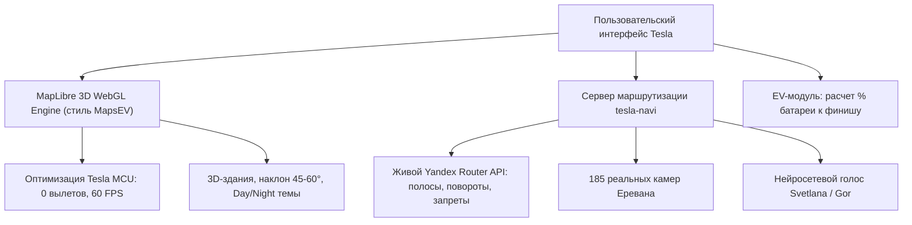

# 🗺️ План разработки гибридной навигации: MapsEV 3D + Яндекс «Мозг»

Этот документ фиксирует архитектурный план и будет пополняться вашими замечаниями и правками перед каждым шагом.

---

## 🎯 Главная цель гибрида
Взять **лучшее от MapsEV** (легкий 60 FPS 3D-интерфейс, оптимизация под процессор Теслы, экономия батареи) и соединить с **лучшим от Яндекса** (настоящие живые маршруты по Еревану, знаки полос, камеры и человеческий голос), выбросив все слабые стороны MapsEV (их кривой роутер по OSM).

---

## 📋 Пошаговые этапы реализации

### Этап 1: Оптимизация движка под экран и процессор Tesla (Анти-краш)
> [!IMPORTANT]
> Главная проблема браузера Теслы — утечки памяти при долгой непрерывной работе WebGL.

- [x] Внедрить точные флаги производительности MapsEV в `map-engine.js`:
  - `fadeDuration: 0` (мгновенное появление тайлов без тяжелых альфа-анимаций);
  - `maxTileCacheZoomLevels: 1` (жесткое ограничение кэша в оперативной памяти машины);
  - `antialias: false` (максимальный и стабильный FPS на экранах с высоким разрешением);
  - `renderWorldCopies: false` (отключение рендера повторов карты за пределами видимости);
  - `refreshExpiredTiles: false` (блокировка фоновых перезагрузок).
- [x] Добавить обработчик восстановления WebGL-контекста (`webglcontextlost` / `webglcontextrestored`), чтобы если память машины перегрузится — карта сама мгновенно перезапустилась без зависания страницы.

---

### Этап 2: Графика и визуальный стиль MapsEV (Дневная / Ночная тема и 3D)
- [ ] **Цветовая палитра MapsEV**:
  - *День:* мягкие асфальтово-серые дороги, спокойный фон без пестроты.
  - *Ночь:* глубокий темно-синий (`#0f1419` / `#1c2940`), не слепящий глаза водителя.
- [ ] **3D-здания**: аккуратная плавная экструзия зданий (`fill-extrusion`) с деликатной высотой и тенями.
- [ ] **Золотая 3D-стрелка машины**: курсор направления с плавным лагом поворота (без микродерганий при остановках).
- [ ] **Кнопка 2D / 3D**: переключение с изометрического куба (плоский вид сверху для развязок ↔ перспективный наклон 45°–60° на трассе).

---

### Этап 3: Интеграция живого маршрута Яндекса в векторный 3D-мир
- [ ] Отрисовка маршрута поверх векторной карты яркой многоцветной линией с реальными пробками Яндекса (зеленый / желтый / красный / бордовый).
- [ ] Встроенный блок маневров:
  - Знаки полосности (наш обновленный блок со стрелками и светящейся точкой вашего ряда);
  - Название следующей улицы;
  - Голосовые команды (*«Держитесь левее/правее»*, *«Поверните налево/направо»*).
- [ ] Коридор камер скорости: показывать предупреждение о камере только тогда, когда она расположена строго по ходу движения машины на текущей полосе.

---

### Этап 4: EV-функции (Электромобиль и Батарея)
- [ ] **Предиктор заряда батареи**:
  - Отображение прогноза остатка заряда на финише: *«Прибытие: 42%»*.
  - Расчет расхода с учетом перепада высот по Армении (подъемы в горы на Севан/Цахкадзор расходуют больше, спуски рекуперируют).
  - Предупреждение о необходимости зарядки на обратный путь.
- [ ] **Слой зарядных станций**:
  - Быстрые фильтры по разъемам: `CCS2`, `GB/T` (для американских/китайских авто), `Type 2`.
  - Показ мощности (50 кВт, 120 кВт, 150 кВт) и кнопка «Поехать».

---

## 📝 Слот для ваших текущих и будущих правок
*(Сюда мы добавляем все ваши пункты перед тем, как перейти к коду)*

1. `[В очереди]` Ваши новые пожелания и найденные нюансы (запишем сюда)...
2. `[В очереди]` ...
3. `[В очереди]` ...

---

## ⚙️ Правила выполнения:
- **Никаких изменений без проверки:** каждый шаг сначала тестируется локально в headless Chrome и проверяется на отсутствие консольных ошибок.
- **Пошаговость:** делаем один конкретный блок, вы проверяете в машине или браузере, утверждаете — и идем к следующему.
- **Полная сохранность контекста:** этот файл лежит в проекте, поэтому ничего не потеряется при любых обновлениях диалога.
